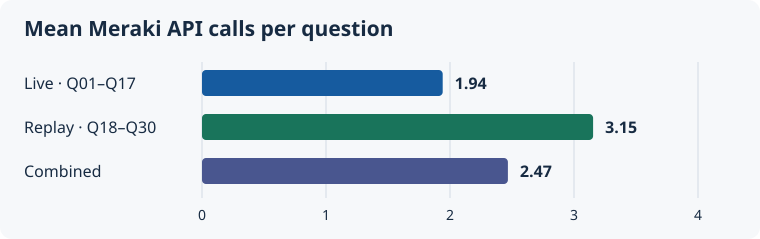
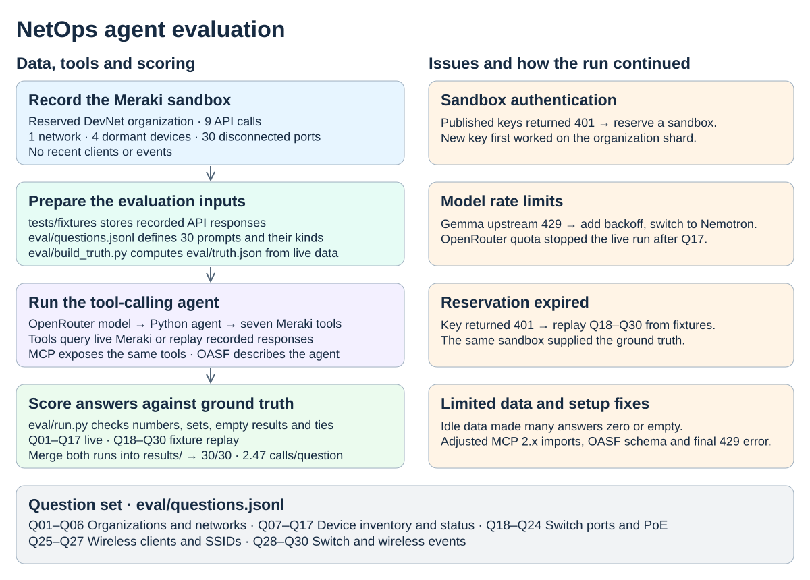

# netops-agent

A Python agent that answers network operations questions ("which switch ports flapped today?", "which SSIDs have the most clients?") by calling the Cisco Meraki Dashboard API. The tools are exposed through an MCP server so other agents can call them, and the agent is described by an [AGNTCY OASF](https://docs.agntcy.org/oasf/open-agentic-schema-framework/) record.

Evaluated on 30 questions whose ground truth is computed by code from raw API responses.

## Evaluation results

Nemotron 3 Ultra scored **30/30** across a live run and a replay of real responses recorded from the same Meraki DevNet sandbox.

| Run | Correct | Mean Meraki API calls per question |
|---|---:|---:|
| Live · Q01–Q17 | 17/17 | 1.94 |
| Replay · Q18–Q30 | 13/13 | 3.15 |
| Combined | 30/30 | 2.47 |



The live run stopped at question 17 when the OpenRouter free quota ran out. The sandbox expired before the remaining questions could run live, so questions 18–30 used recorded responses. The two segments cover different questions. The sandbox had no recent clients or events and no connected switch ports, so many expected answers were zero or empty.

See the [raw results](results/2026-11-18_nvidia-nemotron-3-ultra-550b-a55b-free_full.json) and [build log](LOG.md#metrics).

## Layout

| Path | What |
|---|---|
| `src/netops_agent/client.py` | Meraki API client: bearer auth, 429 retry with `Retry-After`, `Link` pagination, call counter |
| `src/netops_agent/tools.py` | Tools as typed functions: orgs, networks, devices, device statuses, switch port statuses, clients per SSID, events |
| `src/netops_agent/server.py` | MCP server (official `mcp` SDK) exposing the tools |
| `src/netops_agent/agent.py` | Tool-calling loop over any OpenAI-compatible chat completions API |
| `eval/` | 30 questions, `build_truth.py` (ground truth from raw API data), `run.py` (scorer) |
| `agntcy/record.json` | OASF agent record, validated against the OASF schema server |
| `tests/` | Offline tests; API responses served from `tests/fixtures` |

## Setup

```sh
uv sync
cp .env.example .env   # then fill in keys
set -a; source .env; set +a
```

| Variable | Default | Purpose |
|---|---|---|
| `MERAKI_API_KEY` | none | Meraki Dashboard API key |
| `MERAKI_BASE_URL` | `https://api.meraki.com/api/v1` | API base URL; a brand-new key may briefly need its org's shard host (e.g. `https://n190.dashboard.meraki.com/api/v1`) |
| `LLM_BASE_URL` | `https://openrouter.ai/api/v1` | OpenAI-compatible endpoint |
| `LLM_API_KEY` | none | LLM key (needed only for the agent and `eval/run.py`) |
| `LLM_MODEL` | `google/gemma-4-31b-it:free` | Model with tool calling |

## Use

```sh
uv run netops-agent "Which devices are offline?"     # agent
uv run netops-mcp                                     # MCP server on stdio
uv run python eval/build_truth.py                     # ground truth from the live API
uv run python eval/build_truth.py --fixtures tests/fixtures   # offline
uv run python eval/run.py                             # score the agent, writes results/
uv run pytest                                         # offline tests
```

`eval/truth.json` and `tests/fixtures` come from a live DevNet Meraki sandbox recorded 2026-11-16. That sandbox is small and idle, so many answers are 0 or none (see LOG.md).

## Synthetic benchmark

```sh
uv run python eval/run.py --synthetic
uv run python eval/build_truth.py --synthetic  # refresh expected answers after editing fixtures
```

The synthetic suite reuses the 30 questions with [invented Meraki data](eval/fixtures/synthetic) spanning two organizations and three networks. Wired clients, unrelated switch events, mixed device and port states, and a tied model ranking exercise filtering and aggregation. The runner checks complete JSON answers and reports accuracy, API requests per question, and mean API requests across the run. Failed questions still count toward both metrics.

Meraki requests replay locally without credentials. The runner uses the configured LLM endpoint. For a fully offline model run, set `LLM_BASE_URL` to a local OpenAI-compatible endpoint that supports tool calls, set `LLM_MODEL` to its model, and provide a nonempty `LLM_API_KEY` accepted by that endpoint. The test suite also exercises the benchmark with a scripted model and needs no endpoint.

## Evaluation workflow



Open the [editable Excalidraw scene](docs/eval-workflow.excalidraw) in Excalidraw. The [30 questions](eval/questions.jsonl) cover organizations and networks, device inventory and status, switch ports and PoE, wireless clients and SSIDs, and event logs.

The [recorded API responses](tests/fixtures) support offline tests and replay. The [ground-truth builder](eval/build_truth.py) computes the [expected answers](eval/truth.json) from raw Meraki responses, and the [evaluation runner](eval/run.py) scores the agent and writes the [results](results/). The [build log](LOG.md#issues) details the authentication failures, rate limits, sandbox expiry, and limits of the idle dataset.
